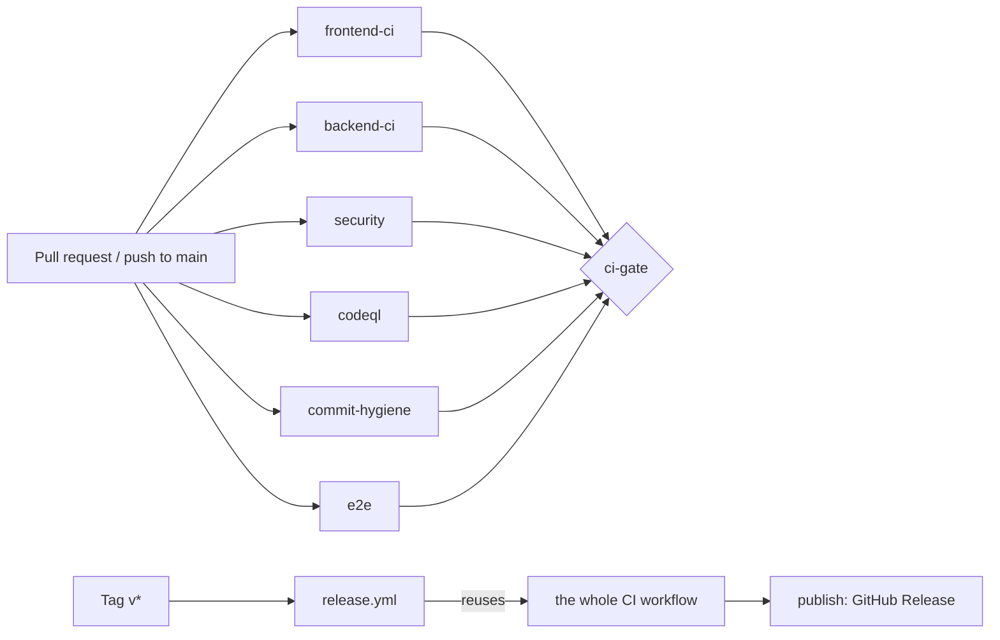

# CI/CD

How ParkSmart's pipeline works, how to run every check on your machine, and what to set up on GitHub.

## Pipeline



`.github/workflows/ci.yml` runs on every pull request (whatever its base, so stacked PRs are checked too), on pushes to `main`, by hand from the Actions tab, and as a reusable workflow from `release.yml`. There are no `paths:` filters: a required check that never starts blocks the merge.

| Job | What it does | Fails when |
|---|---|---|
| `frontend-ci` | `npm ci` → ESLint → Vitest → `vite build` → size-limit budget → uploads `frontend-build` | a lint error or more than the allowed warnings, a failing test, a broken build, or a bundle over budget |
| `backend-ci` | `npm ci` → ESLint → unit tests → starts a single-node MongoDB replica set → all tests under c8 → uploads `backend-coverage` | a lint error, a failing test, or coverage under the floor |
| `security` | tests the audit check → `npm audit` of production dependencies → gitleaks over the full history → dependency review (PRs only) | a high or critical advisory that isn't allow-listed (or whose entry expired), a secret in any commit, or a PR adding a high-severity dependency |
| `codeql (javascript-typescript)`, `codeql (actions)` | CodeQL analysis of the app code and of the workflows, uploaded to code scanning | the analysis can't run. New alerts show up as GitHub's separate code-scanning check on the PR; a ruleset makes that check blocking (see the checklist) |
| `commit-hygiene` | AI-attribution trailer scan and commitlint over every commit in the PR (or the pushed range) | a forbidden trailer or a non-conventional message |
| `e2e` | placeholder; the Playwright suite lands in Phase 6 | never (yet) |
| `ci-gate` | runs last, even if something failed | any job above didn't succeed (failed, cancelled or skipped) |

Settings shared by every job:

- **Node** comes from `.nvmrc` (26, Active LTS since 2026-10-28; Node 24 is in maintenance until April 2028). Both packages declare `"engines": { "node": ">=24" }`.
- **Least privilege:** the workflow token is `contents: read`. Only `codeql` adds `security-events: write`, and only `release.yml`'s `publish` job gets `contents: write`. Checkouts don't persist credentials.
- **Pinned actions:** every third-party action is pinned to a full commit SHA with the version in a comment. Dependabot keeps them current.
- **Concurrency:** a new push to a PR cancels its older run; runs on `main` always finish.
- **No secrets:** nothing in CI needs a real credential, so PRs from forks work. Providers (Cashfree, Geoapify, vehicle catalogues) are mocked in the tests.

### Why the backend starts MongoDB itself

Transactions (needed from Phase 7) only work on a replica set. GitHub service containers can't pass `--replSet` to `mongod`, so `scripts/start-mongo-replset.sh` runs `mongo:7.0` in Docker with `--replSet rs0` and initiates it. The member advertises `127.0.0.1:27028`, so the tests' plain `mongodb://127.0.0.1:27028` connection string finds the primary with no extra options. Redis joins CI in Phase 3, when the backend first uses it.

### Thresholds and how to ratchet them

| Check | Where | Current value | Baseline when set |
|---|---|---|---|
| Backend coverage floor | `backend/.c8rc.json` | lines and statements 77%, functions 77%, branches 62% | 78.35 / 78.35 / 78.7 / 63.67% |
| Frontend lint warnings | `frontend/package.json` (`--max-warnings`) | 59 | 59 |
| Entry JS (gzip) | `frontend/.size-limit.json` | 116 kB | 110.5 kB |
| All JS (gzip) | same | 435 kB | 422.5 kB |
| All CSS (gzip) | same | 32 kB | 30.2 kB |

When a change improves a number, move the threshold with it in the same PR: raise the coverage floor, lower the warning cap. Raise a size budget only on purpose, and say why in the commit (for example, the axios security update added 6.7 kB to the entry chunk).

### The audit allow-list

`.github/audit-allowlist.json` lists advisories we've accepted, each with the GHSA id, the package, the reason and an expiry date. `scripts/audit-prod-deps.mjs` fails on any high or critical advisory that isn't listed, and on any listed one whose date has passed, so every exception gets looked at again. It warns when an entry is no longer needed. Today it holds better-auth's two advisories until 2026-12-31: both need OAuth or OAuth Proxy sign-in, which ParkSmart doesn't enable, and better-auth is removed in Phase 4.

Moderate advisories don't fail the build but should be read: today, react-router 6 has advisories that are only fixed in v7.

## Running every check locally

Use Node 26: `nvm use` reads `.nvmrc`. If your default is older, `nvm alias default 26`; the git hooks need Node 22.12 or newer.

```bash
npm install                    # root: installs the git hooks (Husky), commitlint, lint-staged, Prettier

cd frontend && npm ci
npm run lint                   # ESLint, warnings capped
npm test                       # Vitest
npm run build && npm run size  # bundle budget

cd ../backend && npm ci
npm run lint
npm run test:unit              # no database needed
../scripts/start-mongo-replset.sh   # needs Docker; or run mongod --replSet rs0 yourself
TEST_MONGODB_URI=mongodb://127.0.0.1:27028 npm run test:coverage

cd ..
node --test scripts/                         # tests for the audit check
node scripts/audit-prod-deps.mjs             # production dependency audit
gitleaks git --redact .                      # if you have gitleaks installed
scripts/check-commit-clean.sh origin/main..HEAD
npx commitlint --from origin/main --to HEAD
```

Without Docker, start a replica set with a local `mongod`:

```bash
mongod --port 27028 --bind_ip 127.0.0.1 --replSet rs0 --dbpath /tmp/parksmart-test-db --fork --logpath /tmp/parksmart-test-db.log
mongosh --port 27028 --eval "rs.initiate({ _id: 'rs0', members: [{ _id: 0, host: '127.0.0.1:27028' }] })"
```

Stop the Docker one with `docker stop parksmart-test-mongo` (it removes itself).

## Git hooks

`npm install` at the repo root runs Husky, which points `core.hooksPath` at `.husky/_` for this clone.

- **pre-commit** runs lint-staged. Each package has its own `.lintstagedrc.json`, and a staged file uses the closest one: ESLint `--fix` on JavaScript, Prettier on JSON and YAML. A lint error stops the commit.
- **commit-msg** runs `scripts/strip-ai-trailers.sh`, which removes AI attribution lines (patterns in `scripts/commit-hygiene-patterns.txt`; real `Co-authored-by` lines are kept), then commitlint.

Prettier is configured (`.prettierrc.json`: single quotes, 120 columns) but doesn't yet run on JS/JSX/CSS, because most source files predate it and formatting a whole file on its first touch would bury the real change. A one-time format commit would switch that on (see the Phase 1 report). It stays off Markdown on purpose: it pads tables to equal widths, so a one-cell edit rewrites the whole table.

`git worktree` checkouts don't get the hooks until you run `npm install` inside them, because `core.hooksPath` is relative.

Don't skip hooks with `--no-verify`. CI repeats the same checks anyway.

## Commit messages

Conventional Commits (`feat(scope): …`, `fix: …`, `ci: …`, `docs: …`), checked by `commitlint.config.mjs`. Two deliberate changes from `config-conventional`:

- `subject-case` is off, because subjects often start with a product or provider name ("Cashfree bank account check", "EV bays page").
- Dependabot's commits are skipped, because their bodies carry long release-note lines.

## Releases

Releases start from a tag you push by hand:

```bash
git switch main && git pull
git tag -a v1.0.0 -m "v1.0.0"
git push origin v1.0.0
```

`release.yml` runs the whole CI workflow against the tag. If it passes, `publish` checks that the tag is on `main`, generates notes with git-cliff (`cliff.toml` groups commits by type) and creates the GitHub Release. Preview the notes with `npx git-cliff@2.14.2 --unreleased --tag vX.Y.Z`.

Why git-cliff rather than release-please: release-please drives releases through bot PRs that bump versions and push tags itself, which needs write access to `main` and doesn't fit a hand-pushed tag. git-cliff only reads history.

Nothing is deployed from GitHub Actions yet. Docker image build, push and scan jobs arrive in Phase 3, and the backend deploy job in Phase 14 once the host is chosen.

## Deployments and environments

**Frontend (Vercel).** Vercel builds previews for PRs and production from `main` using `frontend/vercel.json` (Vite preset, `build` output, SPA rewrite). Variables are baked in at build time, so redeploy after changing them:

| Variable | Value | Notes |
|---|---|---|
| `REACT_APP_API_URL` | `https://<backend>/api` | required |
| `REACT_APP_AUTH_URL` | `https://<backend>` | defaults to the API origin |
| `REACT_APP_SOCKET_URL` | `https://<backend>` | optional, defaults to the API origin |

Vite exposes both `VITE_*` and `REACT_APP_*` (`envPrefix` in `vite.config.js`), but the app reads only the three `REACT_APP_*` names today. New variables (Clerk's publishable key in Phase 5) will use `VITE_*`, and the existing names keep working. Never put backend secrets in Vercel.

**Backend.** Deployed by its host (Render today); the platform host is decided before Phase 14.

**GitHub Environments.** Create these under Settings → Environments now; they're used once the deploy jobs exist.

| Environment | Protection | Secrets it will hold |
|---|---|---|
| `staging` | deploys from `main`; no reviewer needed | `MONGODB_URI` (staging database), Clerk test keys (Phase 4), Redis URL (Phase 3), Razorpay **test** keys and webhook secret (Phase 11), host deploy token (Phase 14) |
| `production` | required reviewer: the repository owner; deploy only from `v*` tags | the production equivalents of the above, Razorpay test keys until you go live |

CI itself never uses these environments or their secrets.

## Adding a required check

1. Add the job to `ci.yml` with a stable `name:`.
2. Add it to `ci-gate`'s `needs:` list. Nothing else is needed if branch protection requires only `ci-gate`.
3. If you also list it by name in branch protection, it must run on every PR. Use in-job change detection to skip heavy steps, never a workflow `paths:` filter.

## Branch protection checklist (for the owner)

Settings → Branches (or Rules → Rulesets) → `main`:

- [ ] Require a pull request before merging, with 1 approval
- [ ] Dismiss stale approvals when new commits are pushed
- [ ] Require review from Code Owners (`.github/CODEOWNERS`)
- [ ] Require status checks to pass, and require branches to be up to date
  - [ ] `ci-gate` (the one that matters)
  - [ ] optionally also `frontend-ci`, `backend-ci`, `security`, `commit-hygiene`
- [ ] Require conversation resolution before merging
- [ ] Require linear history, or allow merge commits only (pick one policy and keep it)
- [ ] Block force pushes and deletions on `main`
- [ ] Apply the rules to administrators too
- [ ] Settings → Code security: keep the dependency graph and Dependabot alerts on; turn on secret scanning and push protection (free for public repos)
- [ ] Code scanning: if CodeQL **default setup** is on, switch it to the advanced workflow in this repo (the two can't both upload)
- [ ] Rulesets → "Require code scanning results" for CodeQL, blocking on high-or-higher security alerts, so a new CodeQL alert stops the merge

## Failure modes, checked in Phase 1

Each check was broken on purpose and confirmed to fail, then reverted:

| Broken on purpose | Caught by | Result |
|---|---|---|
| Wrong assertion in a backend unit test | `backend-ci` → `npm run test:unit` | exit 1 |
| Wrong assertion in a frontend test | `frontend-ci` → Vitest | 1 failed test, exit 1 |
| Entry budget lowered below the bundle | `frontend-ci` → size-limit | "exceeded by 10.54 kB", exit 1 |
| Coverage floor raised to 95% | `backend-ci` → c8 | "Coverage for lines (78.35%) does not meet global threshold (95%)", exit 1 |
| Allow-list entries set to expire yesterday | `security` → audit check | two `::error` lines, exit 1 |
| A GitHub token committed in a file | `security` → gitleaks | "leaks found: 1" |
| `Co-Authored-By: Claude …` written via `git commit-tree`, skipping hooks | `commit-hygiene` → trailer scan | commit named, exit 1 |
| Commit message "updated stuff" | `commit-hygiene` → commitlint; and the commit-msg hook | type and subject empty; hook refused the commit |
| AI trailer in a normal `git commit` | commit-msg hook | trailer removed; a real `Co-authored-by` line kept |
| Unused variable in a staged file | pre-commit hook | ESLint failed and the commit was refused |
| One required job failed and one was cancelled | `ci-gate` | "Required jobs did not succeed: backend-ci, codeql", exit 1 |

These ran locally with the same commands and scripts the workflow uses. The first PR run on GitHub confirms the workflow wiring.
